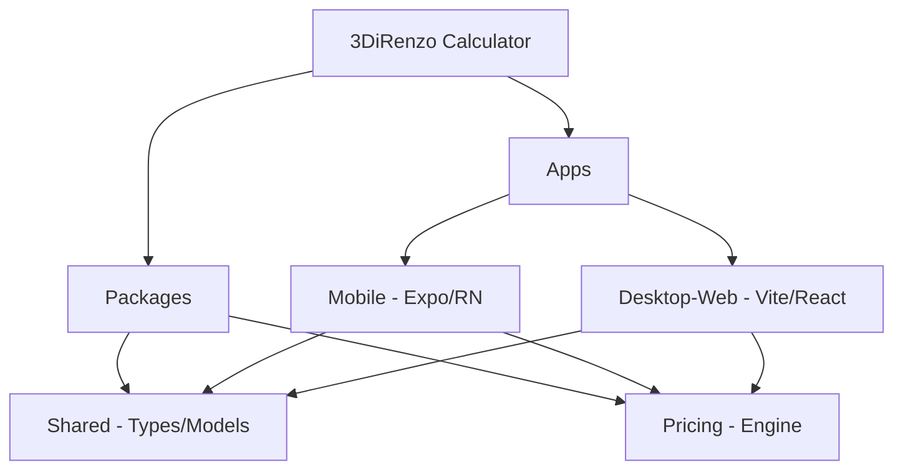

# 🏗️ Arquitetura Técnica - 3DiRenzo Calculator

Este documento descreve a arquitetura técnica, decisões de design e padrões utilizados no projeto.

## 📋 **Índice**

- [Visão Geral da Arquitetura](#visão-geral-da-arquitetura)
- [Decisões de Design](#decisões-de-design)
- [Estrutura de Dados](#estrutura-de-dados)
- [Engine de Cálculo](#engine-de-cálculo)
- [Gerenciamento de Estado](#gerenciamento-de-estado)
- [Sistema Multi-tenant](#sistema-multi-tenant)
- [Padrões de Código](#padrões-de-código)

## 🎯 **Visão Geral da Arquitetura**

### **Arquitetura Monorepo**


### **Stack Tecnológica**

| Camada | Tecnologia | Justificativa |
|--------|------------|---------------|
| **Mobile** | React Native + Expo | Performance nativa, desenvolvimento rápido, ecosystem maduro |
| **Web** | React + Vite | Mesma base de código, build rápido, HMR |
| **Desktop** | Tauri (futuro) | Bundle pequeno, performance nativa |
| **Estado** | Zustand | Simples, performático, TypeScript-first |
| **Navegação** | Expo Router | File-based, type-safe, padrão moderno |
| **Tipos** | TypeScript | Type safety, melhor DX, documentação viva |

## 🎲 **Decisões de Design**

### **1. Por que React Native ao invés de Flutter?**

**Decisão**: React Native + Expo
**Alternativas**: Flutter, Ionic, Native

**Justificativa**:
- ✅ Compartilhamento de código com web (React)
- ✅ Ecosystem JavaScript maduro
- ✅ Expo simplifica desenvolvimento e deploy
- ✅ Performance adequada para o caso de uso
- ✅ Flexibilidade para customizações nativas

### **2. Por que Zustand ao invés de Redux?**

**Decisão**: Zustand
**Alternativas**: Redux Toolkit, Context API, Jotai

**Justificativa**:
- ✅ Menos boilerplate que Redux
- ✅ TypeScript nativo
- ✅ Performance superior ao Context
- ✅ Curva de aprendizado menor
- ✅ Bundle size menor

### **3. Por que Monorepo?**

**Decisão**: PNPM + Turbo Monorepo
**Alternativas**: Repositórios separados, Yarn Workspaces

**Justificativa**:
- ✅ Compartilhamento de código entre plataformas
- ✅ Versionamento sincronizado
- ✅ Facilita refatorações cross-platform
- ✅ CI/CD simplificado
- ✅ PNPM é mais eficiente que NPM/Yarn

## 📊 **Estrutura de Dados**

### **Modelos Principais**

```typescript
// Printer - Impressora 3D
interface Printer {
  id: string;
  tenantId: string;        // Multi-tenant
  name: string;
  tech: 'FDM' | 'MSLA';   // Tecnologia
  powerW: number;          // Potência em Watts
  machineRate?: number;    // Taxa por hora (opcional)
  failRatePct: number;     // Taxa de falha %
}

// Filament - Material FDM
interface Filament {
  id: string;
  tenantId: string;
  name: string;
  pricePerKg: number;      // Preço por kg
  density: number;         // g/cm³ (PLA ~1.24)
  diameterMm: 1.75 | 2.85; // Diâmetro padrão
}

// Resin - Material MSLA
interface Resin {
  id: string;
  tenantId: string;
  name: string;
  pricePerL: number;       // Preço por litro
  densityGml?: number;     // Densidade (opcional)
  lossPct: number;         // Perdas no processo %
}
```

### **Inputs de Cálculo**

```typescript
// Input para cálculo FDM
interface QuoteInputFDM {
  printer: Printer;
  filament: Filament;
  tPrintH: number;         // Tempo em horas
  massG: number;           // Massa em gramas
  energyTariff: number;    // Tarifa kWh
  prepH: number;           // Horas preparação
  postH: number;           // Horas pós-processo
  prepRph: number;         // R$ por hora prep
  postRph: number;         // R$ por hora pós
  extrasR?: number;        // Extras (embalagem, etc)
  pricing: {
    mode: 'markup' | 'margin';
    valuePct: number;
  };
  taxPct?: number;         // Impostos %
}

// Input para cálculo MSLA (similar structure)
interface QuoteInputMSLA {
  // ... similar fields with volumeMl instead of massG
}
```

## ⚙️ **Engine de Cálculo**

### **Princípios de Design**
1. **Pureza**: Funções puras sem side effects
2. **Determinismo**: Mesmo input = mesmo output
3. **Auditabilidade**: Breakdown detalhado de custos
4. **Extensibilidade**: Fácil adicionar novos fatores

### **Fórmula Implementada**

```typescript
export function priceFDM(input: QuoteInputFDM): PriceResult {
  // 1. Custos base
  const cMat = (input.massG / 1000) * input.filament.pricePerKg;
  const cEnergy = (input.printer.powerW / 1000) * input.tPrintH * input.energyTariff;
  const cMachine = (input.printer.machineRate ?? 0) * input.tPrintH;
  const cPrep = input.prepH * input.prepRph;
  const cPost = input.postH * input.postRph;
  const extras = input.extrasR ?? 0;

  // 2. Subtotal
  const subtotal = cMat + cEnergy + cMachine + cPrep + cPost + extras;

  // 3. Ajuste por falhas
  const adjusted = subtotal * (1 + input.printer.failRatePct / 100);

  // 4. Markup ou Margem
  const preTax = input.pricing.mode === 'markup'
    ? adjusted * (1 + input.pricing.valuePct / 100)
    : adjusted / (1 - input.pricing.valuePct / 100);

  // 5. Impostos
  const final = preTax * (1 + (input.taxPct ?? 0) / 100);

  return {
    breakdown: { cMat, cEnergy, cMachine, cPrep, cPost, extras, subtotal, adjusted },
    price: { preTax, final }
  };
}
```

### **Validações**
- Inputs positivos
- Percentuais válidos (0-100)
- Printer e material existem
- Tipos corretos (FDM com filament, MSLA com resin)

## 🗄️ **Gerenciamento de Estado**

### **Arquitetura Zustand**

```typescript
interface AppState {
  // Data
  printers: Printer[];
  filaments: Filament[];
  resins: Resin[];
  currentTenant: string;
  
  // UI
  isLoading: boolean;
  
  // Actions
  addPrinter: (printer: Printer) => void;
  // ... other CRUD operations
  
  // Selectors
  getPrintersByTenant: (tenantId?: string) => Printer[];
}
```

### **Padrões de Estado**
1. **Imutabilidade**: Sempre criar novos objetos
2. **Normalização**: IDs únicos para todos entities
3. **Derivation**: Computed values via selectors
4. **Persistência**: Auto-save com AsyncStorage

### **Persistência**
```typescript
export const useAppStore = create<AppState>()(
  persist(
    (set, get) => ({ /* state */ }),
    {
      name: '3dquote-storage',
      storage: createJSONStorage(() => AsyncStorage),
    }
  )
);
```

## 🏢 **Sistema Multi-tenant**

### **Estratégia de Isolamento**
- **Data**: `tenantId` em todos os models
- **UI**: Filtragem automática por tenant ativo
- **Stores**: Getters que filtram por tenant
- **Futuro**: Backend com RLS (Row Level Security)

### **Fluxo Multi-tenant**
```typescript
// 1. Login define tenant ativo
setCurrentTenant('empresa-abc');

// 2. Todos os gets filtram automaticamente
const printers = getPrintersByTenant(); // só da empresa-abc

// 3. Todos os creates incluem tenant
addPrinter({ ...printerData, tenantId: currentTenant });
```

### **Benefícios**
- Isolamento completo de dados
- Fácil adicionar novos tenants
- Preparado para SaaS multi-tenant
- Whitelabel ready

## 📱 **Padrões de UI**

### **Estrutura de Componentes**
```
components/
├── ui/           # Componentes base (Button, Input)
├── forms/        # Formulários complexos
├── cards/        # Cards de dados (PrinterCard)
└── screens/      # Telas completas
```

### **Padrões de Style**
- **StyleSheet**: Para performance
- **Consistência**: Design system with tokens
- **Responsividade**: Adaptação mobile/tablet
- **Acessibilidade**: Labels e navigation

### **Navegação**
```typescript
// File-based routing com Expo Router
app/
├── _layout.tsx      # Root layout
├── index.tsx        # Home screen
├── quote.tsx        # Quote screen
└── (tabs)/         # Tab navigation (futuro)
```

## 🔒 **Segurança e Performance**

### **Segurança**
- **Validação**: Todos os inputs validados
- **Sanitização**: Dados limpos antes de cálculo
- **Type Safety**: TypeScript elimina classes de bugs
- **Isolation**: Multi-tenant data isolation

### **Performance**
- **Memoização**: React.memo em componentes pesados
- **Lazy Loading**: Telas carregadas sob demanda
- **Bundle Splitting**: Packages independentes
- **State Optimization**: Zustand com minimal re-renders

## 🚀 **Deploy e Build**

### **Estratégia de Build**
- **Mobile**: EAS Build (Expo Application Services)
- **Web**: Vite build + Vercel/Netlify
- **Desktop**: Tauri build (futuro)

### **Environments**
- **Development**: Local com hot reload
- **Staging**: Preview builds para testes
- **Production**: Builds otimizados e minificados

## 📈 **Roadmap Técnico**

### **Próximas Melhorias**
1. **Backend Integration**: Supabase + PostgreSQL
2. **Offline Sync**: Robust offline-first
3. **File Processing**: G-code parsing
4. **PDF Generation**: Template engine
5. **Testing**: Unit + Integration tests
6. **CI/CD**: Automated testing and deployment

### **Debt Técnico**
- Implementar testes unitários comprehensive
- Adicionar error boundaries
- Melhorar error handling
- Implementar logging structured
- Performance monitoring

---

Este documento é vivo e deve ser atualizado conforme o projeto evolui.